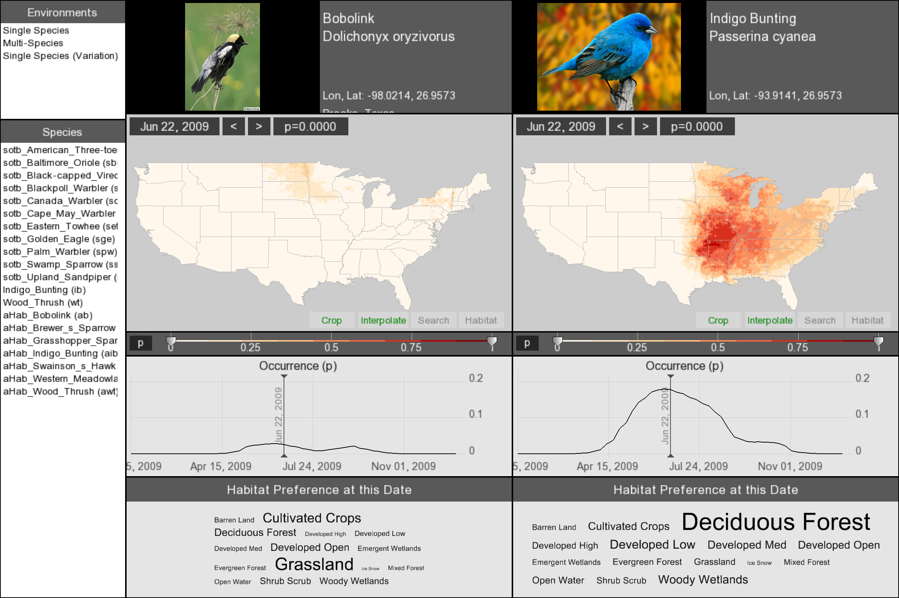
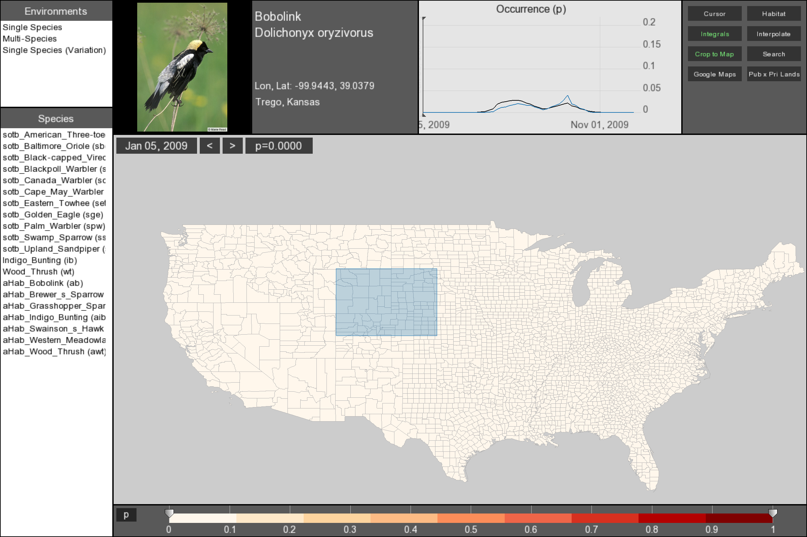
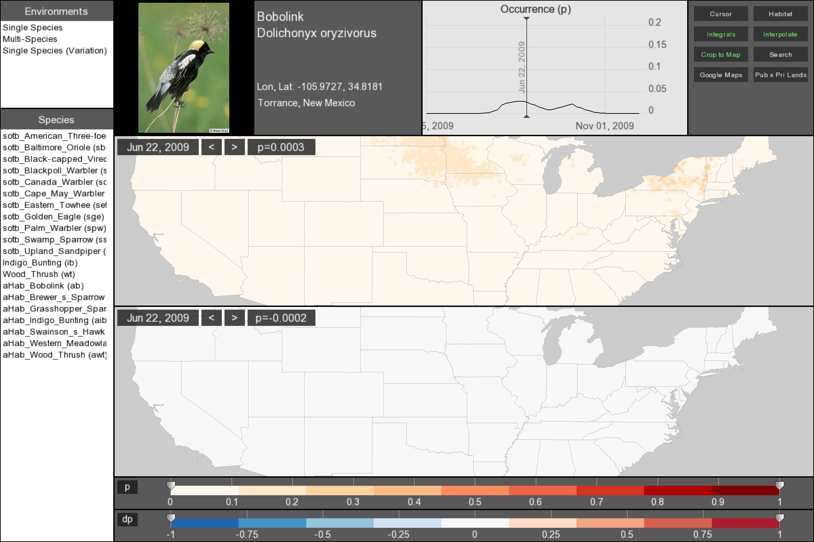

# BirdVis

Bird-distribution visualization, ported to Qt6/C++17 while retaining the legacy
OpenGL renderer and embedded R calculations. The macOS development build has
been verified with all 20 supplied datasets and native interaction tests.

## Screenshots

Compare Bobolink and Indigo Bunting occurrence maps, seasonal curves, and habitat
predictors side by side.



Select a region on the map to view its linked occurrence curve alongside the
curve for the full area.



Explore occurrence and week-to-week variation together.



## Build and run

Requires a C/C++17 compiler, CMake 3.21+, Qt6 (Core, Gui, Widgets, OpenGL,
OpenGLWidgets; Test for the test targets), desktop OpenGL/GLU, GLEW, GDAL, Boost
headers, FreeImage, R, Rcpp, and RInside. Dependencies must match the build
architecture. The verified machine uses Qt 6.11.2, R 4.6.1, Rcpp 1.1.2,
RInside 0.2.19, GDAL 3.13.3, and GLEW 2.3.1.

For a project-local R package library, run from the repository:

```sh
R --vanilla --slave -e 'dir.create(".R-library", showWarnings=FALSE); install.packages(c("Rcpp", "RInside"), lib=".R-library", repos="https://cloud.r-project.org")'
R_LIBS_USER="$PWD/.R-library" cmake -S . -B build
cmake --build build -j 4
ctest --test-dir build --output-on-failure
./build/birdvis
```

CMake records the selected R installation and package-library locations, including
the configure-time library in the `BIRDVIS_R_LIBS_USER` cache setting. The
application supplies them when `R_HOME` and `R_LIBS_USER` are unset. It also
records absolute source-tree data/resource/image paths, so launching from
another working directory works. Override these with `BIRDVIS_DATA`,
`BIRDVIS_RESOURCES`, or `BIRDVIS_IMAGES` as needed. Dataset discovery is recursive;
the 11 files under `data/BVdata_sotb_experiments/` appear alongside the original
nine files.

This is a development build, not a relocatable macOS application bundle.
Linux builds, signed distribution, and bundled R have not been verified.

## Source layout

- `src/app` entry point; `src/env` the three workflows (single, multi-species, variation)
- `src/dataflow` module graph; `src/modules` its concrete modules
- `src/data` datasets, R access, regions, area estimation; `src/render` OpenGL, fonts, textures
- `src/ui` events and layout; `src/math` vectors, colors, colormaps, utilities
- `tests/`, `docs/`, `cmake/`, plus `data/`, `resources/` and `images/` at runtime

## Using the interface

- Drag an environment from the upper-left list into the main area. Enter rows
  and columns, such as `1 1` or `1 2`. Cancel preserves the existing view.
- Drag species from the lower-left list onto a map. Multi-Species accepts a
  different species in each panel; Variation shows occurrence and weekly change.
- Drag with the left mouse button to pan; use the wheel or trackpad to zoom.
  Drag with the right mouse button to create or resize a selection; drag a
  selection with the left button to move it. Delete removes the selection under
  the pointer.
- Left/Right arrows step dates. `M` cycles borders, `I` toggles interpolation,
  and `S` toggles clipping to the US map, with the pointer over a map.
- Over a colormap, Tab changes the palette, `X` edits stop values using an R
  expression, and Space over a handle opens the color dialog. Handles can be
  dragged.
- Search accepts a state (`Florida`) or county and state (`Graham, Kansas`).
  It uses the original local boundaries. The obsolete online city-geocoding
  service is not used. Map links and auxiliary images open through the desktop.

## Verification

CTest covers all bundled datasets, date parsing, grid extraction, spatial sums,
temporal curves, first/subsequent variation frames, invalid input, font decoding,
and missing-resource startup diagnostics. Spatial queries use inclusion–exclusion
on the stored summed-area matrices. Font atlas pixels are compared against the
legacy decoder, including orientation and channel choice.

Native tests require a desktop display:

```sh
./build/gl_probe
./build/native_check /tmp/birdvis-check.png
```

`native_check` exercises area/framebuffer-state restoration, species drag/drop,
all three environments, selection curves, pan/zoom (including pixel wheel
input), time stepping, interpolation/stencil/borders, colormap dialogs,
cancellation, local place search, resizing/minimizing/restoring, and window
recreation. It saves screenshots and runs from a temporary working directory.
These are synthesized Qt interactions on a native display, using Qt dialogs for
repeatable automation; physical trackpad
hardware and other displays/platforms still need user testing.

See [PLAN.md](PLAN.md) for the migration record and verification limits.

## Original resources

State/county shapefiles and font atlases were recovered from
`/Users/csilva/birdvis_06_16_2011/birdvis.app/Contents/Resources`. Source paths and
SHA-256 checksums are in [resources/provenance.json](resources/provenance.json).
The 28 font description/SGI files match the accompanying `fonts.zip` exactly.
The original map geometries were preserved because they affect area estimates.

All datasets contain 52 weekly dates from January 5 through December 28, 2009.
The additional experimental datasets include several encodings of absent
predictors; these are normalized in memory without altering the source files.
The Golden Eagle auxiliary image `Golden_Eagle_AAB.jpg` was not present in the
original distribution. Its main photograph is available; requesting the absent
auxiliary image shows an explanatory message.
